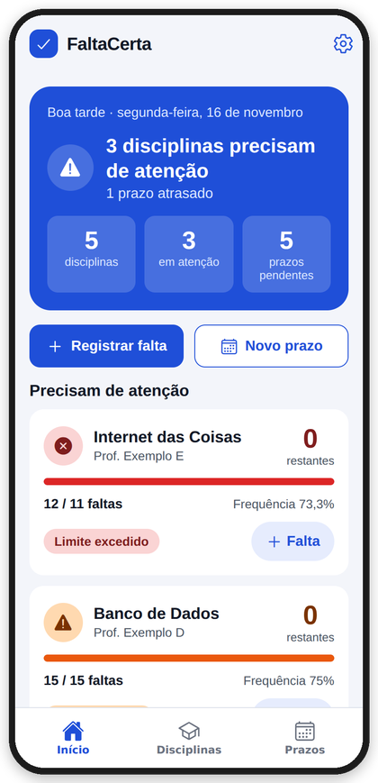
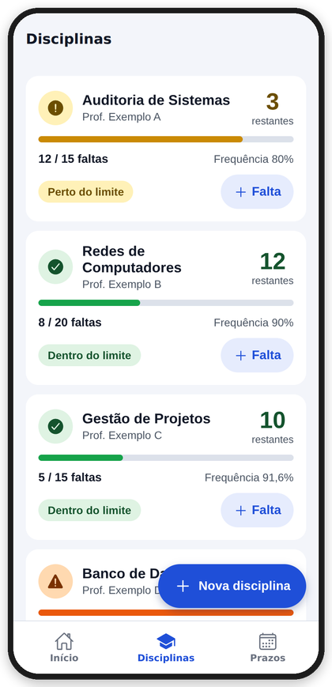
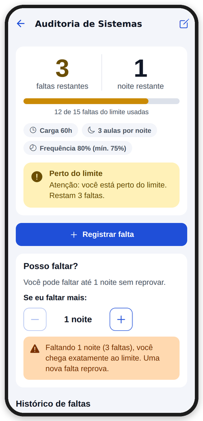
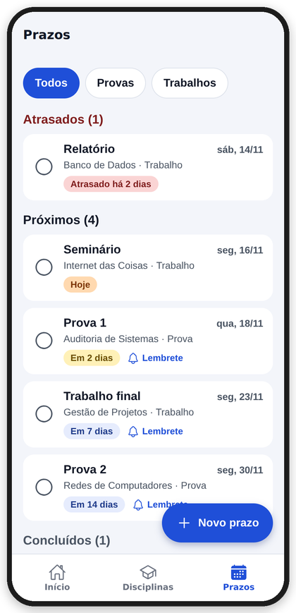

# FaltaCerta

**A conta certa das suas faltas e prazos.**


Aplicativo móvel que mostra ao estudante **quantas faltas ainda pode ter** em cada disciplina, **avisa antes do limite** e **lembra provas e trabalhos**. Os dados ficam só no celular: não precisa de login, de internet nem de servidor.

Projeto da disciplina de Gestão de Projetos (ADS, 5º período), desenvolvido com Scrum em 3 Sprints de 1 semana.

<p align="center">
  
  
  
  
</p>
<p align="center"><sub>Telas com dados de exemplo (Modo demonstração).</sub></p>

## Por que existe

Numa pesquisa anônima com estudantes (25 respostas válidas), **76%** disseram perder a conta das faltas às vezes ou mais, e **20%** já reprovaram por falta. A ideia teve **72%** de validação, acima da meta de 70%.

## Funcionalidades

- **Disciplinas e limite de faltas:** cadastro com carga horária e aulas por noite, com prévia do limite.
- **Registro de faltas por noite**, com atalhos Hoje e Ontem e prévia de como a disciplina fica antes de confirmar.
- **Alerta configurável** quando restam poucas faltas (padrão: 3).
- **“Posso faltar?”:** simula faltar mais noites antes de decidir.
- **Provas e trabalhos** com lista de prazos (atrasados, próximos e concluídos) e filtro por tipo.
- **Lembretes no celular** antes do prazo (padrão: 1 dia antes, às 08:00), configuráveis.
- **Painel inicial** com o resumo do dia, frequência em % e a tela “Como calculamos”.
- **Modo demonstração:** carrega dados de exemplo ou apaga tudo (em Configurações).

## Como o limite de faltas é calculado

- O limite é **25% da carga horária** (frequência mínima de 75%), **arredondado para baixo**.
- Cada hora de aula vale **1 falta**. Uma noite de 3 aulas vale 3 faltas.
- Exemplos: 60 h com 3 aulas por noite = 15 faltas (5 noites); 45 h = 11 faltas (3 noites).
- Chegar exatamente ao limite ainda aprova; ultrapassar reprova.

> O FaltaCerta é uma ferramenta de acompanhamento pessoal: os registros são feitos por você e **não substituem o sistema oficial da instituição**.

## Como rodar

Pré-requisitos: [Node.js](https://nodejs.org) (versão LTS) e o app **Expo Go** no celular (Android ou iPhone).

```bash
git clone https://github.com/giovaniowz/faltacerta.git
cd faltacerta
npm install
npx expo start
```

Escaneie o QR code do terminal com o Expo Go. Para ver o app com dados prontos, abra **Configurações > Modo demonstração > Carregar dados de exemplo**.

Se algo não atualizar na tela, reinicie com `npx expo start -c` (limpa o cache).

## Testes

```bash
npm test              # 190 testes (regras, armazenamento, lembretes e fila)
npx tsc --noEmit      # checagem de tipos
```

Há também um teste opcional que simula o app inteiro em `opcional/fluxo.test.tsx`. Ele precisa de `@testing-library/react-native` e `react-test-renderer`; copie o arquivo para `src/__smoke__/` e rode `npx jest src/__smoke__`.

## Tecnologias

React Native 0.88 e Expo SDK 58, TypeScript, React Navigation (abas e pilha), AsyncStorage, expo-notifications (notificações locais) e Jest.

## Estrutura

```
src/
├── domain/        regras puras e testadas: limite, faltas, prazos, lembretes, simulação
├── storage/       leitura e gravação no aparelho (AsyncStorage)
├── state/         estado do app, fila de operações e sincronização dos lembretes
├── notificacoes/  agendamento de notificações locais
├── screens/       telas
├── components/    componentes de interface
├── navegacao/     tipos das rotas
├── theme/         cores e medidas
└── testes/        apoio para os testes
```

As regras de negócio ficam em `src/domain`, sem depender de tela nem de celular. Por isso são testadas sem abrir o app.

## Privacidade

Os dados (disciplinas, faltas e prazos) ficam **somente no celular**. O app não pede login, não usa servidor e não coleta dados pessoais.

## Limitações e próximos passos

- Não há integração com o portal acadêmico nem sincronização em nuvem.
- Ainda não há APK publicado para Android; no iPhone, o uso é pelo Expo Go.
- Próximos passos: testar com mais estudantes, gerar o APK e avaliar a integração com o portal.

## Autores

Giovani Dalagassa (Product Owner e Developer) e Erick de Almeida Florentino dos Santos (Scrum Master e Developer).

## Licença

[MIT](LICENSE).
